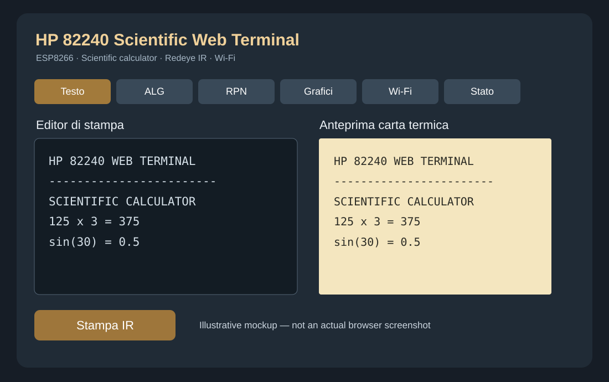
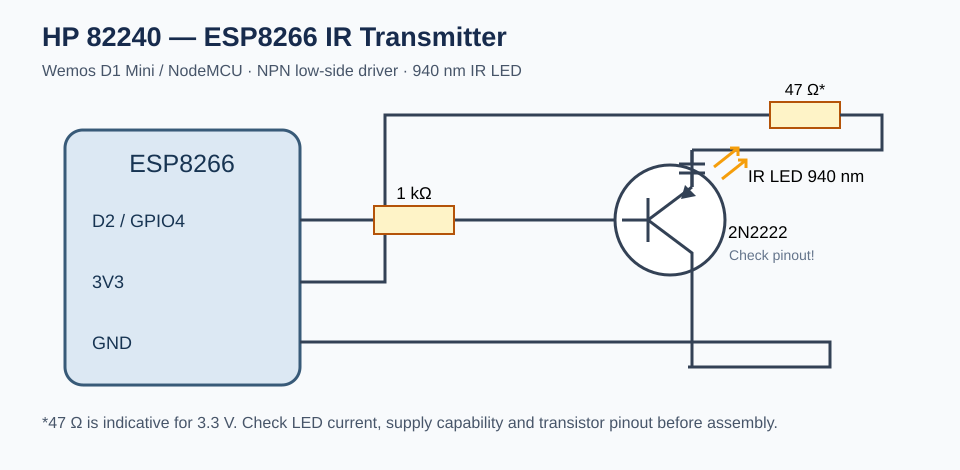

# HP 82240 Scientific Web Terminal

Experimental ESP8266 Wi-Fi scientific calculator and infrared printing terminal for **HP 82240A/B**.

**Status: v0.1.0, experimental. Infrared waveform and actual printing have NOT been verified on hardware. Do not use on untrusted networks.**

Features: free text preview, ALG and RPN, conversions, graph/ASCII output, HTTP printing endpoint, Wi-Fi SSID scanning and a fallback AP.

## Documentation
- [English guide](docs/README.en.md)
- [Guida italiana](docs/README.it.md)
- [Architecture and protocol limitations](docs/ARCHITECTURE.md)

## Quick start
```sh
pio run -t upload
pio run -t uploadfs
```

Connect to `HP82240-Setup`, open `http://192.168.4.1`, scan networks, select SSID and enter password. **The setup AP has no password in this prototype.**

Default hardware: ESP8266 D2/GPIO4 -> 1kOhm -> NPN base; IR LED 940nm in collector circuit with a properly rated series resistor. Verify actual transistor pinout.

## API test
```sh
curl -X POST http://192.168.4.1/api/print --data-urlencode 'plain=HELLO HP 82240'
```

HTTP success only acknowledges attempted IR transmission, not physical printing.

## License
Copyright © 2026 Gianpaolo P.. Licensed under [PolyForm Noncommercial 1.0.0](LICENSE); commercial use requires a separate written license. Third-party licenses remain unaffected.

## Web interface preview



*Concept preview, not an actual browser screenshot.*

## ESP8266 infrared transmitter circuit



Check actual 2N2222 pinout, LED current and 3.3 V supply before wiring. IR protocol remains experimental and has not been bench-tested.
